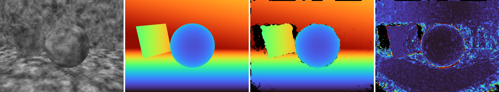

# COLMAP dense reconstruction on CuMetal



*View 4 of the synthetic scene: input image, true depth, the depth COLMAP's
PatchMatch computed on the Apple GPU, and its relative error (0 to 2%). Errors
concentrate at occlusion boundaries and image borders, as they do for
PatchMatch on any GPU.*

COLMAP is the standard photos-to-3D pipeline and the first step of nearly every
Gaussian-splatting and NeRF workflow. Its dense stage — `patch_match_stereo`,
which turns a sparse model into per-image depth and normal maps — exists only as
CUDA. On a Mac it stops with *"Dense stereo reconstruction requires CUDA"*.
This demo builds unmodified COLMAP 4.2.1 with `CUDA_ENABLED=ON` against CuMetal
and runs the standard dense pipeline on the Apple GPU:

```bash
bash demos/colmap/run.sh               # build COLMAP, render, reconstruct, gate
bash demos/colmap/run.sh --skip-build  # reuse the last COLMAP build
```

Prerequisites: a Release CuMetal build with the binary shim
(`cmake -B build-release-shim -DCMAKE_BUILD_TYPE=Release -DCUMETAL_ENABLE_BINARY_SHIM=ON`),
Homebrew LLVM, and
`brew install boost ceres-solver eigen flann gflags glog metis openimageio suite-sparse faiss libomp glew sqlite`.
If Homebrew's `cumetal` (≤ 0.8.0) is installed, `brew unlink cumetal` first: it
links CUDA headers into `/opt/homebrew/include`, where they collide with this
tree's.

## Result

Recorded on Apple M4 Pro, 2026-11-09, ten 640×480 views,
`--PatchMatchStereo.geom_consistency true`:

| | |
| --- | --- |
| Kernel launches | 11,800 across 14 kernels, all `device=apple_gpu launch_success=true` |
| Depth coverage after filtering | 78–96% per view (edge views lowest) |
| Kept depths within 1% of truth | 97–99% per view |
| Per-view median depth error | 0.05–0.08% |
| Fused points (`stereo_fusion`) | 73,549, 97.9% within 1 cm of the true surface, median 2.5 mm |
| `patch_match_stereo` wall time | 12 min 2 s (18 min 44 s before the texture-fetch work) |

It is correct but slow. COLMAP launches one thread per image column, so a sweep
is 20 threadgroups of 32 threads walking every row: the GPU is mostly idle and
each thread's latency is the whole cost. CuMetal implements texture fetches in
software; reading the descriptor once per fetch, a clamp/border-only path for
unnormalized coordinates and branch-free bilinear taps cut a layered fetch from
about 615 ns to 270 ns. Sampling through Metal textures in hardware is the next
large step.

## How it is checked

COLMAP has no CPU PatchMatch, so there is no second build of the solver to
compare against. The reference is the scene itself. `make_scene.py` ray-casts
ten views of a ground plane, back wall, tilted panel and sphere, each with a
view-consistent procedural texture, and writes the exact camera poses as a
COLMAP sparse model. Every pixel's true depth is known, and so is every fused
point's distance to the true surface.

`gate.py` requires, per view, ≥ 70% depth coverage, ≥ 75% of kept depths within
1% of truth and a median relative error ≤ 0.2%; and, for the fused cloud, ≥ 50,000
points with ≥ 95% within 1 cm of the surface. The thresholds sit below the
recorded run with room for PatchMatch's randomness. A miscompiled build
measured on the same scene had 0.5% of depths within 1% and a 72% median error,
so the bar separates correct from broken by a wide margin. `run.sh` also refuses
a pass unless every kernel launch in CuMetal's trace ran on the Apple GPU and
none failed.

## What it took

COLMAP itself is not patched. Every change is a general CuMetal fix with its
own test:

- **PTX module slicing.** `patch_match_cuda.cu` compiles to a 63 MB PTX module
  with 208 kernel entries. The registration JIT parsed and lowered the whole
  module for every kernel; it now lowers only what the kernel can reach.
- **Runtime-guarded private stores.** `GpuMatView::GetSlice` fills a stack
  `float normal[3]` in a loop whose trip count is a runtime `size_t`. The typed
  backend cannot prove that store clear of the pointers kept in the same stack
  frame, so it now guards it: a store that would overwrite a live pointer is
  skipped and the launch fails with `cudaErrorLaunchFailure`. The guard's
  report does not cancel the kernel, so it costs a few compares, not the
  per-loop polling a cancelling trap needs (which made sweeps 11× slower).
- **Texture handles dereferenced by a member function.** The kernel stores its
  `cudaTextureObject_t` arguments in the cost computer struct and only
  `Compute()` reads them. They were bound as integers, so the GPU read through
  host addresses and every cost came out as the maximum. Parameter inference
  now follows a handle through the struct into the helper, and a handle the
  kernel passes straight to an out-of-line helper
  (`ComputeGeomConsistencyCost`, once faster texture fetches made Clang stop
  inlining it) is a pointer too.
- **Texture semantics.** `cudaAddressModeBorder` returns zero outside the
  texture and `tex2DLayered` honours linear filtering, as COLMAP expects.
- **Typed PTX importer:** 2-byte struct returns read/written as one `b16` word
  (`Eigen::half`); `__constant__` reads from out-of-line helpers; libdevice
  calls known not to write private memory; `selp`-indexed tables of private
  pointers; parameters spilled to the stack.
- **Eigen's GPU fp16 path** (`__half_raw`, half2 math, `__half` shuffles).
- **nvcc shim:** `--default-stream per-thread`, and `--cuda-inline-threshold`
  to inline device helpers the way nvcc does.
- Legacy `cudaGL*BufferObject` entry points (SiftGPU), refusing with
  `cudaErrorNotSupported`.

## Files

| File | Purpose |
| --- | --- |
| `run.sh` | build, render, `image_undistorter` → `patch_match_stereo` → `stereo_fusion`, provenance check, gate |
| `make_scene.py` | synthetic scene renderer and exact COLMAP sparse model |
| `gate.py` | depth-map and fused-cloud accuracy against the analytic scene |
| `../../scripts/build_colmap_cumetal.sh` | pinned COLMAP 4.2.1 build against CuMetal's toolkit shim, with why each flag is there |

Only dense reconstruction is demonstrated. SiftGPU's CUDA feature extraction
compiles but is not exercised here; the sparse model comes from the renderer.
